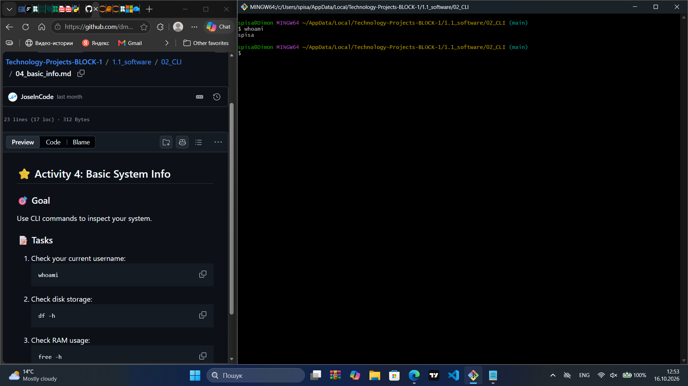

## ⭐ Activity 4: Basic System Info

### 🎯 Goal  
Use CLI commands to inspect your system.

### 📝 Tasks
1. Check your current username:
   ```bash
   whoami
   ```
2. Check disk storage:
   ```bash
   df -h
   ```
3. Check RAM usage:
   ```bash
   free -h
   ```

**Upload screenshots for every step**



