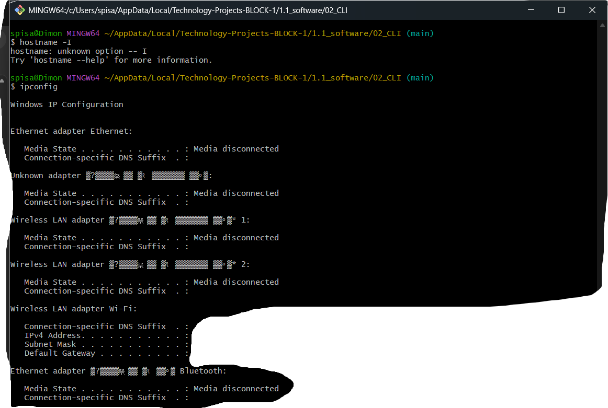
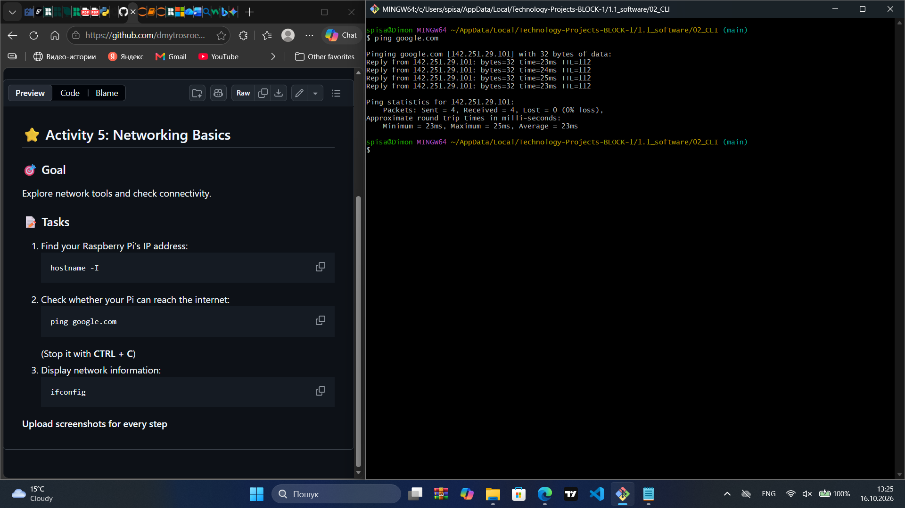
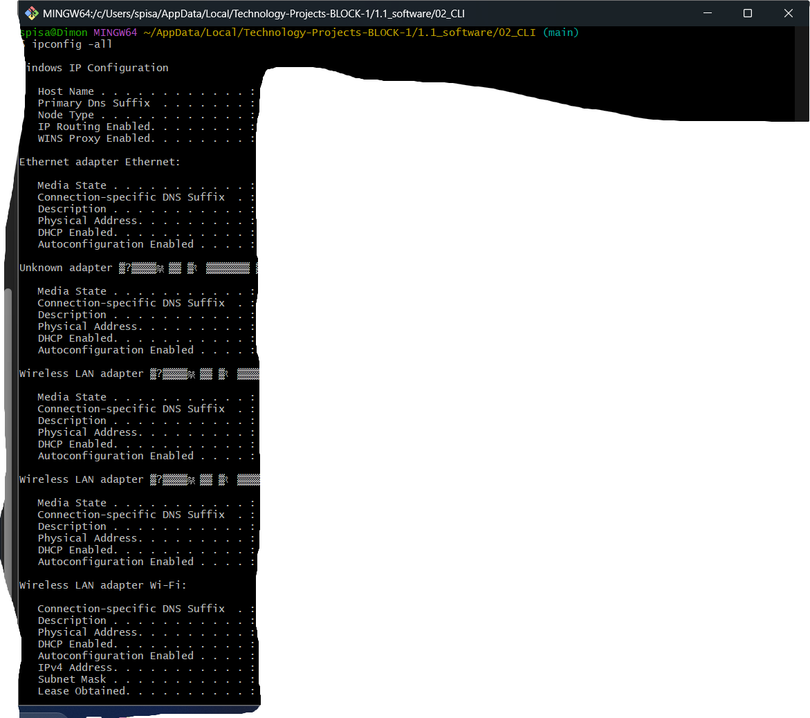

## ⭐ Activity 5: Networking Basics

### 🎯 Goal  
Explore network tools and check connectivity.

### 📝 Tasks
1. Find your Raspberry Pi’s IP address:
   ```bash
   hostname -I
   ```
2. Check whether your Pi can reach the internet:
   ```bash
   ping google.com
   ```
   (Stop it with **CTRL + C**)
3. Display network information:
   ```bash
   ifconfig
   ```

**Upload screenshots for every step**



